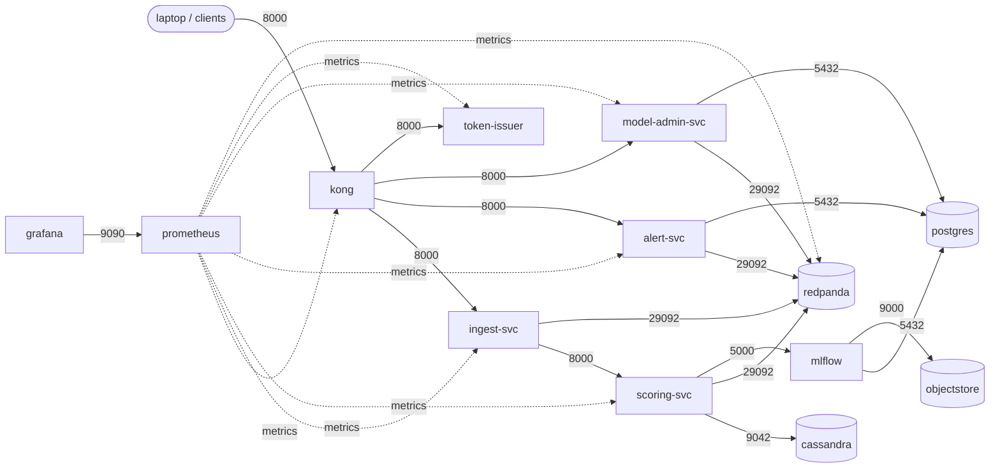

# Network isolation (week 4, step 3)

Threat 4: an attacker who takes over one pod uses it to reach the databases or other services.
Control: on Kubernetes, every connection is denied unless it is on the list below, in both
directions. Test: ST4 (`make k8s-st4`). Results: `docs/results/security.md`.

Files: `deploy/k8s/base/network.yaml` (the policies), `deploy/k8s/base/serviceaccounts.yaml`,
`security/tests/network_paths.py` (the list, used by ST4 and by `tests/test_k8s_manifests.py`).

## Allowed paths

| From | To | Port | Why |
|---|---|---|---|
| anyone (NodePort 30080) | kong | 8000 | the public entrance |
| kong | ingest-svc, alert-svc, model-admin-svc, token-issuer | 8000 | the routes in `deploy/kong/kong.tpl.yml` |
| ingest-svc | scoring-svc | 8000 | a decision per payment |
| ingest-svc | redpanda | 29092 | txn.raw, txn.scored, dlq.txn |
| scoring-svc | cassandra | 9042 | user history |
| scoring-svc | redpanda | 29092 | model.events (promotions) |
| scoring-svc | mlflow | 5000 | download a promoted model |
| alert-svc | redpanda, postgres | 29092, 5432 | txn.scored; cases and the audit log |
| model-admin-svc | redpanda, postgres | 29092, 5432 | model.events; the audit log |
| mlflow | postgres, objectstore | 5432, 9000 | the registry's database and files |
| grafana | prometheus | 9090 | dashboard queries |
| prometheus | our services (8000), kong (8100), redpanda (9644) | | metrics |
| prometheus | the Kubernetes API | 443, 6443 | finding pods; CPU numbers |
| every pod | CoreDNS (kube-system) | 53 | names |

Everything else is denied: for example ingest to Postgres, scoring to Postgres, token-issuer to
anything, or any pod to Kong from inside.

## How it is built

- **Default deny, both directions** (`default-deny`, every pod in the namespace), then **one
  policy per workload**: who may call it, and whom it may call. A path is open only if both ends
  allow it.
- **Rules name pods by their `app` label**, not addresses, so they keep working as pods move.
  A pod with no labels (the ST4 intruder) matches no allow rule: it can only look up names.
- **The laptop tools still work:** `kubectl port-forward` (the `make k8s-*` tunnels) and
  `kubectl exec` reach the pod through the container runtime, not the pod network, so the
  policies don't apply to them. Kubernetes' probes come from the node, which k3s's policy
  enforcer always lets through.
- **Prometheus reaches the Kubernetes API** by address (the API's Service, 10.43.0.1, and the
  k3d nodes on Docker's 172.16.0.0/12 network). This is the one rule that depends on the
  cluster's addresses; a rebuilt cluster on another Docker network would need it changed.
- **Enforcement:** k3s's built-in policy controller (it is not turned off in `make cluster`).
  Compose has no equivalent: Docker networks don't support these rules, so isolation is
  cluster-only.

## Identities

- **One service account per workload** (`serviceaccounts.yaml`). Before, every pod ran as the
  namespace's `default` account.
- **No Kubernetes API token in any pod except Prometheus's**
  (`automountServiceAccountToken: false`). None of the others calls the API, so a compromised pod
  finds no token to use against the cluster.
- **Database logins:** Postgres has one per service: `alerts` (alert-svc), `model_admin`
  (model-admin-svc), `mlflow`. The owner login `fraud` is used only by the setup scripts and
  `make verify-audit` from the laptop.

## Limits

- **Redpanda has no users yet:** any pod allowed to reach it (ingest, scoring, alert-svc,
  model-admin-svc) can read or write any topic. Topic permissions come with step 5.
- **Rules are per pod, not per request:** ingest may call scoring, so a compromised ingest pod
  can send scoring anything. Signed requests between services (mTLS, step 4) narrow this.
