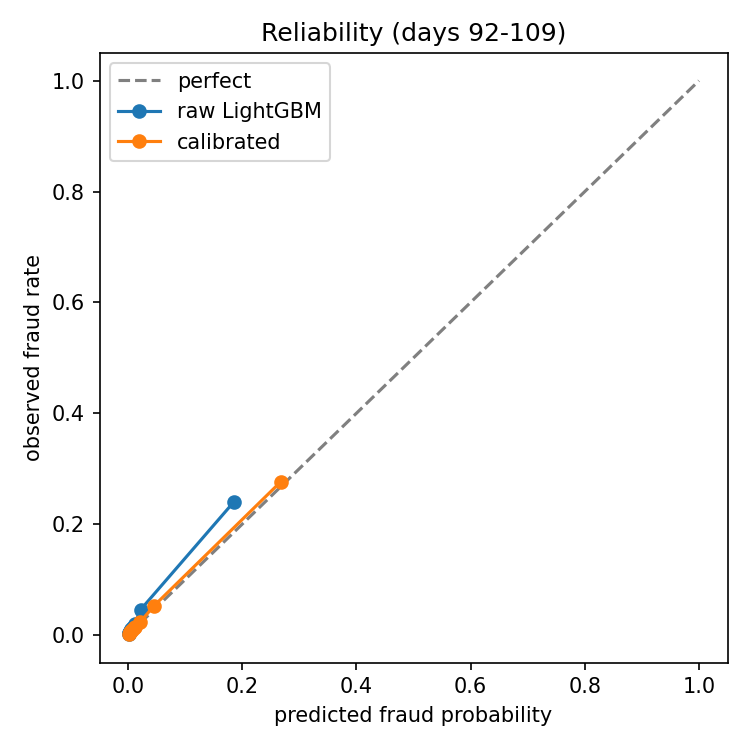

# Calibration and decision thresholds (week 2, steps 5-6)

LightGBM trained on days 1-73 (65 features, raw D). Isotonic calibration fitted on days 74-91; everything below is measured on days 92-109.

Actual fraud rate on days 92-109: 0.0351

## Calibration quality

| scores       |   Brier score |   mean predicted |   PR-AUC |
|:-------------|--------------:|-----------------:|---------:|
| raw LightGBM |        0.0231 |           0.0244 |   0.5179 |
| calibrated   |        0.0228 |           0.0326 |   0.504  |

## Review threshold by assumed review cost

Chosen on days 74-91 to minimise missed fraud dollars + review cost per flagged payment; evaluated on days 92-109.

|   review cost ($) |   review threshold |   flagged (test) | share flagged   |   frauds caught (test) |   frauds total (test) |   expected cost (test, $) |
|------------------:|-------------------:|-----------------:|:----------------|-----------------------:|----------------------:|--------------------------:|
|                 2 |               0.39 |              910 | 1.5%            |                    715 |                  2110 |                    287982 |
|                 5 |               0.39 |              910 | 1.5%            |                    715 |                  2110 |                    290712 |
|                10 |               0.39 |              910 | 1.5%            |                    715 |                  2110 |                    295262 |

## Proposed decision rule (review cost $5)

approve below 0.39, review from 0.39 to 0.7, decline at 0.7 or above (calibrated probabilities).

| decision   |   fraud |   normal |
|:-----------|--------:|---------:|
| approve    |    1395 |    57861 |
| review     |     179 |      133 |
| decline    |     536 |       62 |
