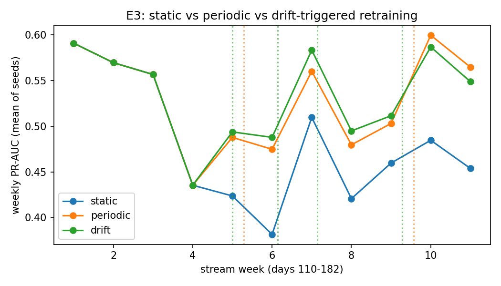

# E3: static vs periodic vs drift-triggered retraining

Offline simulator over stream days 110-182. Labels arrive 14 days late; retrains use the last 60 labelled days; analysts review the top 2% of each day. All strategies start from the same model (days 1-73, tuned v1 settings). Periodic: every 30 days. Drift: ADWIN on missed fraud, 7-day cooldown, at most 1 retrain per week; PSI on the score > 0.2 only logs a warning. Seeds [1, 2, 3].

## Summary (mean and std over seeds)

| strategy   |   PR-AUC (whole stream) (mean) |   PR-AUC (whole stream) (std) |   mean weekly PR-AUC (mean) |   mean weekly PR-AUC (std) |   fraud caught @ 2% reviewed (mean) |   fraud caught @ 2% reviewed (std) |   retrains (mean) |   retrains (std) |   training seconds (mean) |   training seconds (std) |   PSI warning days (mean) |   PSI warning days (std) |
|:-----------|-------------------------------:|------------------------------:|----------------------------:|---------------------------:|------------------------------------:|-----------------------------------:|------------------:|-----------------:|--------------------------:|-------------------------:|--------------------------:|-------------------------:|
| static     |                         0.4903 |                        0.0011 |                      0.4806 |                     0.0022 |                              0.3552 |                             0.0009 |                 0 |                0 |                    0      |                   0      |                         0 |                        0 |
| periodic   |                         0.5316 |                        0.0019 |                      0.5293 |                     0.0024 |                              0.376  |                             0.003  |                 2 |                0 |                   14.8    |                   1.0536 |                         0 |                        0 |
| drift      |                         0.5344 |                        0.0044 |                      0.5327 |                     0.0051 |                              0.3777 |                             0.0026 |                 4 |                1 |                   28.0333 |                   7.4702 |                         0 |                        0 |

## Weekly PR-AUC (mean of seeds)

|   week |   static |   periodic |   drift |
|-------:|---------:|-----------:|--------:|
|      1 |   0.5909 |     0.5909 |  0.5909 |
|      2 |   0.5696 |     0.5696 |  0.5696 |
|      3 |   0.5566 |     0.5566 |  0.5566 |
|      4 |   0.4354 |     0.4354 |  0.4354 |
|      5 |   0.4236 |     0.4877 |  0.4938 |
|      6 |   0.3815 |     0.4748 |  0.4878 |
|      7 |   0.5097 |     0.5602 |  0.5833 |
|      8 |   0.4207 |     0.4796 |  0.4949 |
|      9 |   0.4597 |     0.5031 |  0.5115 |
|     10 |   0.4846 |     0.5997 |  0.5868 |
|     11 |   0.4537 |     0.5647 |  0.5488 |

## Every retrain

|   day | reason                |   rows |   seconds | strategy   |   seed |
|------:|:----------------------|-------:|----------:|:-----------|-------:|
|   140 | every 30 days         | 190185 |       7   | periodic   |      1 |
|   170 | every 30 days         | 177330 |       6.8 | periodic   |      1 |
|   138 | ADWIN on missed fraud | 189460 |       7   | drift      |      1 |
|   146 | ADWIN on missed fraud | 188321 |       6.9 | drift      |      1 |
|   153 | ADWIN on missed fraud | 186155 |       6.9 | drift      |      1 |
|   168 | ADWIN on missed fraud | 178357 |       6.6 | drift      |      1 |
|   140 | every 30 days         | 190185 |       7.6 | periodic   |      2 |
|   170 | every 30 days         | 177330 |       8.3 | periodic   |      2 |
|   139 | ADWIN on missed fraud | 189718 |       7.4 | drift      |      2 |
|   146 | ADWIN on missed fraud | 188321 |       7.1 | drift      |      2 |
|   153 | ADWIN on missed fraud | 186155 |       7.4 | drift      |      2 |
|   168 | ADWIN on missed fraud | 178357 |       7.1 | drift      |      2 |
|   175 | ADWIN on missed fraud | 175593 |       6.8 | drift      |      2 |
|   140 | every 30 days         | 190185 |       7.4 | periodic   |      3 |
|   170 | every 30 days         | 177330 |       7.3 | periodic   |      3 |
|   139 | ADWIN on missed fraud | 189718 |       7.2 | drift      |      3 |
|   146 | ADWIN on missed fraud | 188321 |       6.9 | drift      |      3 |
|   153 | ADWIN on missed fraud | 186155 |       6.8 | drift      |      3 |
