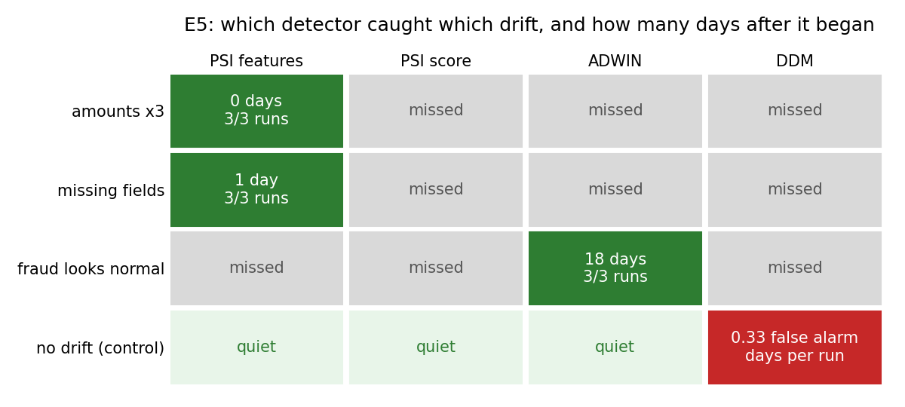

# E5: drift detectors on injected drift (ADWIN vs DDM vs PSI)

Stream days 110-182, shuffled across days so it has no drift of its own. One drift injected from day 140. Model trained on days 1-73, never retrained; analysts review the top 2% each day. PSI compares each day with the first stream week (alarm above 0.2). ADWIN and DDM watch missed fraud; labels arrive 14 days late, so their delay can never be below that. Seeds [1, 2, 3].

Drifts: **amounts x3** (sudden, inputs change); **missing fields** (gradual over 20 days, up to 80% of payments lose M1-M9 and D1-D15); **fraud looks normal** (sudden concept drift, 50% of frauds copy a normal payment's features).

## Detection delay (days after the drift starts)

| drift              | detector     | detected   | mean delay (days)   | fastest-slowest   |
|:-------------------|:-------------|:-----------|:--------------------|:------------------|
| amounts x3         | PSI features | 3/3        | 0.0                 | 0-0               |
| amounts x3         | PSI score    | 0/3        | -                   | -                 |
| amounts x3         | ADWIN        | 0/3        | -                   | -                 |
| amounts x3         | DDM          | 0/3        | -                   | -                 |
| missing fields     | PSI features | 3/3        | 1.0                 | 1-1               |
| missing fields     | PSI score    | 0/3        | -                   | -                 |
| missing fields     | ADWIN        | 0/3        | -                   | -                 |
| missing fields     | DDM          | 0/3        | -                   | -                 |
| fraud looks normal | PSI features | 0/3        | -                   | -                 |
| fraud looks normal | PSI score    | 0/3        | -                   | -                 |
| fraud looks normal | ADWIN        | 3/3        | 18.0                | 18-18             |
| fraud looks normal | DDM          | 0/3        | -                   | -                 |

Feature PSI's first alarm pointed at: amounts x3: log_amount (1.55); missing fields: D1 (0.23) (seed 1).

## False alarms (control, no drift injected)

| detector     |   false alarm days (mean per run) |   worst run |
|:-------------|----------------------------------:|------------:|
| PSI features |                          0        |           0 |
| PSI score    |                          0        |           0 |
| ADWIN        |                          0        |           0 |
| DDM          |                          0.333333 |           1 |

Counted as days with an alarm over the 73 stream days.
