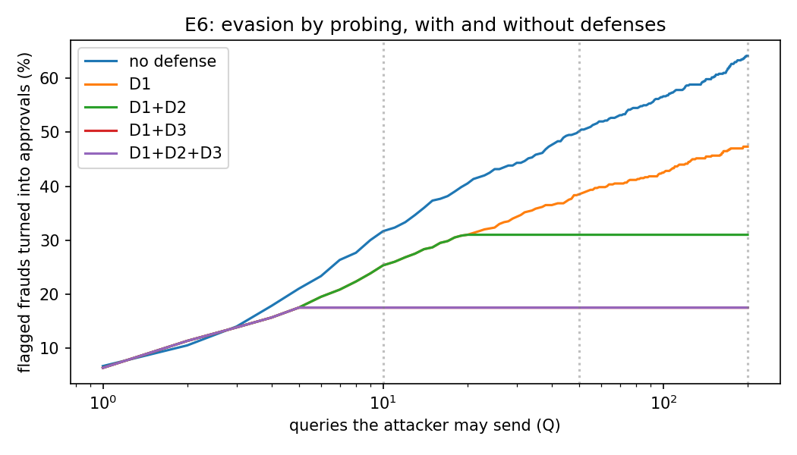

# E6: evasion by probing the API (threat 14)

Model `models/fraud-lgbm-v1-tuned`. 200 frauds per seed that the model flags on the golden days 92-109; the attacker changes only fields they control (amount 50-100% of the original, hour, e-mail domains, device, card brand and type) and succeeds if a variant is approved. Seeds [1, 2, 3]. Simulated offline against the real model; D1-D3 are the platform changes this would justify.

**D1+D2+D3: FAIL: at Q=50 success falls from 50.2% to 17.5%; false positives up by 0.489 points (limit 0.1).**

**D1+D3: PASS: at Q=50 success falls from 50.2% to 17.5%; false positives up by 0.001 points (limit 0.1).**

D1+D3 (no budget) was added after the first run, which showed that the budget (D2) caused almost all of the false positives while adding no protection once probe detection (D3) is on.

## Share of flagged frauds turned into approvals

| defense    | Q=10         | Q=50         | Q=200        |
|:-----------|:-------------|:-------------|:-------------|
| no defense | 31.7% ± 2.1% | 50.2% ± 1.6% | 64.2% ± 0.6% |
| D1         | 25.3% ± 2.1% | 38.5% ± 2.9% | 47.3% ± 2.1% |
| D1+D2      | 25.3% ± 2.1% | 31.0% ± 1.9% | 31.0% ± 1.9% |
| D1+D3      | 17.5% ± 1.1% | 17.5% ± 1.1% | 17.5% ± 1.1% |
| D1+D2+D3   | 17.5% ± 1.1% | 17.5% ± 1.1% | 17.5% ± 1.1% |

D1 hides the score (clients see only the decision); D2 allows 20 payments per card per day; D3 sends every later payment on a card to review after 5 flagged ones within 24 hours.

## Cost for real customers (legitimate payments, days 92-182)

| setting                                                   | legit payments not approved   |
|:----------------------------------------------------------|:------------------------------|
| model only (and D1: hiding the score changes no decision) | 0.305%                        |
| + D2 budget (20 per card per day)                         | 0.793%                        |
| + D2 + D3 probe detection (5 flagged per card in 24 h)    | 0.794%                        |
| + D3 only (no budget)                                     | 0.306%                        |

Cards are the proxy user id (card1 + addr1 + first-seen day); payments whose card cannot be identified are not limited, which is also a gap an attacker could use.
