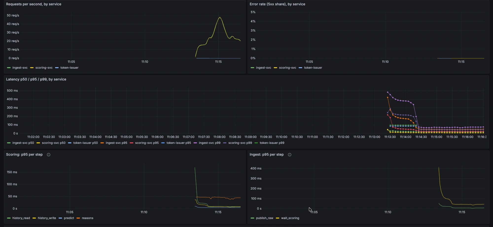
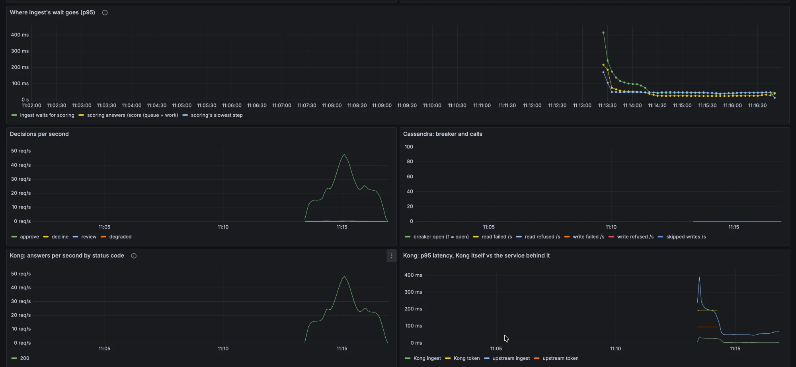
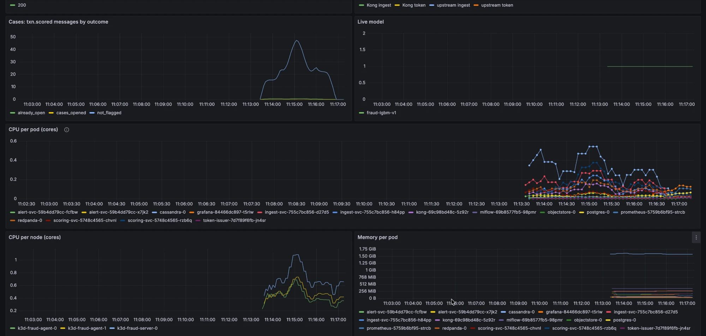

# Metrics: one load run read from the dashboard (week 3, step 7)

k3d cluster (3 nodes on one laptop), backfilled data, model fraud-lgbm-v1, 2 copies each of ingest,
scoring and alert-svc. Design: `docs/metrics.md`. This run finds where time goes; it changes
nothing. Repeated runs at fixed rates are step 8.

## How it was run (5 Nov)

```
make k8s-up                                        # fresh deploy, then straight into the run
make k8s-grafana                                   # dashboard open, last 15 minutes
make replay URL=http://localhost:8080 LIMIT=5000   # 11:13 to about 11:17 local time
make k8s-snapshot MINUTES=6                        # window ending 11:18
make k8s-gc-pauses MINUTES=60
```





## Numbers (`make k8s-snapshot`, 6 minutes ending 11:18)

| Service | Requests | Per second | p50 | p95 | p99 | 5xx |
|---|---|---|---|---|---|---|
| ingest-svc | 5,074 | 14.1 | 21 ms | 54 ms | 166 ms | 0.00% |
| scoring-svc | 5,126 | 14.2 | 10 ms | 30 ms | 54 ms | 0.00% |
| token-issuer | 1 | 0.0 | 88 ms | 99 ms | 100 ms | 0.00% |

Requests per second is the average over the 6 minutes; the replay peaked near 48 per second. The
counts are a little above 5,000 because Kubernetes' health checks are counted too.

| Decisions | Count |
|---|---|
| approve | 5,042 |
| review | 45 |
| decline | 39 |
| degraded (any decision) | 0 (0.0%) |

| Cassandra | Value |
|---|---|
| breaker open | 0 s |
| failed or refused reads and writes | 0 |
| skipped writes | 0 |

| Where ingest's wait goes (p95) | Time |
|---|---|
| ingest waits for scoring | 46 ms |
| scoring answers `/score` (queue + work) | 30 ms |
| scoring step: history_read | 10 ms |
| scoring step: history_write | 9 ms |
| scoring step: predict | 5 ms |
| scoring step: reasons | 46 ms |

`reasons` runs only for the 84 flagged payments, so its p95 describes those alone. That is why it
can be larger than `/score`'s p95, which covers all 5,000.

| Node | Peak CPU (cores, 1-minute average) |
|---|---|
| k3d-fraud-agent-0 | 0.69 |
| k3d-fraud-agent-1 | 0.70 |
| k3d-fraud-server-0 | 1.08 |

## Cassandra pauses (`make k8s-gc-pauses`)

One pause in the last hour: 325 ms at 10:31 local time (18:31 in the log, which is UTC), 40
minutes before the run. None during the run.

## What it explains

1. **A healthy run meets the latency target with room to spare.** p95 through ingest was 54 ms and
   p99 166 ms, with no errors, no degraded payments and no breaker trips.
2. **The breaker opens when Cassandra pauses.** On 4 Nov the breaker opened during pauses of 956 ms
   and 636 ms (`docs/metrics.md`). This run had no pause, and the breaker never opened.
3. **The first minute after a deploy is slow.** For about a minute after the run started, ingest's
   p99 was near 480 ms and its wait for scoring near 400 ms (first screenshot). After 11:14:30 they
   stayed near 70 ms and 50 ms. Likely causes are new connections and the first calls into the
   model and Cassandra, but this run doesn't separate them.
4. **This corrects the compose reading below.** That reading's large gap between "ingest waits" and
   "scoring answers" covered an hour that included compose's startup, so it mostly measured the
   same first-minute slowness. Once warm, the gap here is 16 ms. The idea that scoring's main loop
   can't keep up (the GIL) has no support from this run.
5. **CPU was not short this time.** The busiest node peaked at 1.08 cores. On 4 Nov it reached about
   2.7 cores, when the breaker opened. Why those runs used so much more CPU is not known yet; step 8
   repeats runs to find out.

## The earlier compose reading (5 Nov, last 60 minutes, about 1,000 payments)

| Where ingest's wait goes (p95) | Time |
|---|---|
| ingest waits for scoring | 438 ms |
| scoring answers `/score` (from when its main loop picks the request up) | 77 ms |
| scoring's slowest step (`reasons`) | 49 ms |

Read with point 4 above: the window included startup.

## Left for step 8

- Repeated runs at fixed rates, warm and fresh, for a baseline with spread.
- Measure the first-minute slowness on its own, and check whether a warm-up before taking traffic
  removes it.
- Find what drove CPU to 2.7 cores in the 4 Nov runs.
