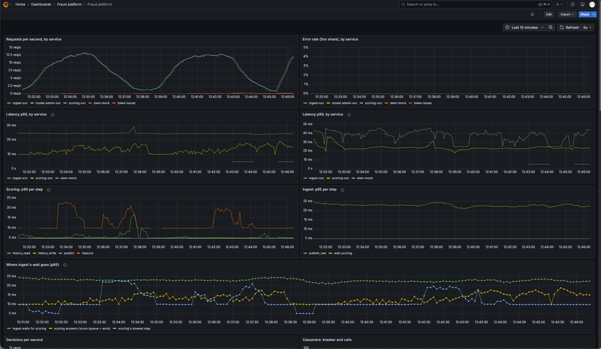
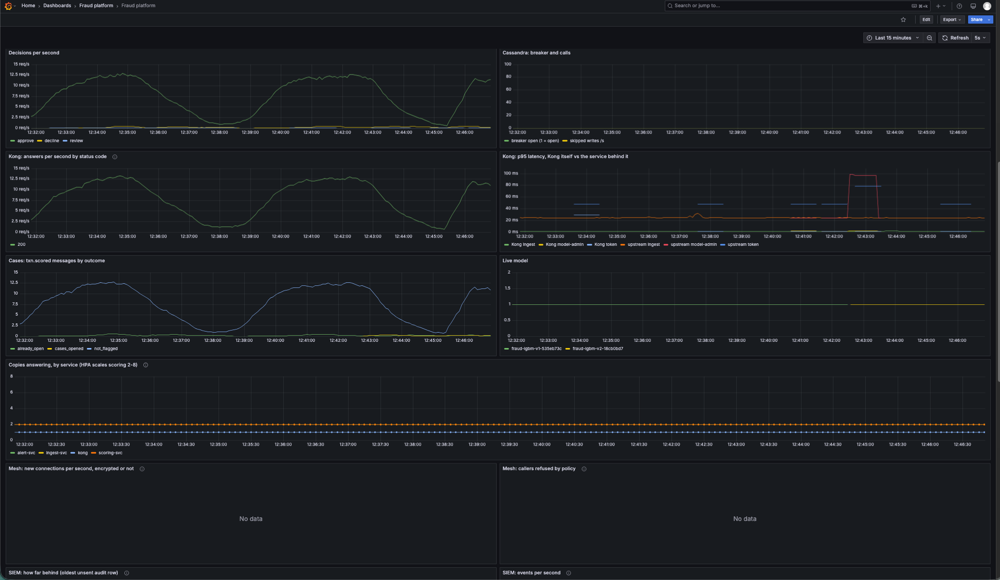

# Admin promote and rollback (week 4, step 6)

Design: `docs/mlflow.md`. Run on compose, then on the k3d cluster (2 scoring pods), 8 Nov 2026.
Models: tuned v1 (`fraud-lgbm-v1-535eb73c`, registry version 4 on both) and the week-2 model
(`fraud-lgbm-v1-ea89630b`, version 5 on compose, 1 on the cluster).

## Who may: ST2 with the model routes (compose and cluster, identical)

| Route | no token | client | analyst | admin |
|---|---|---|---|---|
| See the live model | 401 | 403 | 403 | 200 |
| Model history | 401 | 403 | 403 | 200 |
| Promote a model | 401 | 403 | 403 | 400 |
| Roll back the model | 401 | 403 | 403 | 400 |

Admin's 400 is ST2's unsigned test promotion being refused after Kong and the role check: access is
proven without changing the model. All 32 calls (8 routes x 4 callers) match the roles table.

The first run gave admin **429** on the last two rows: Kong's limit on these routes was 2 per
second, and ST2 sends 4 admin calls in one second (`make promote` sends 2). Raised to 5 per second
and 60 per minute.

## The demo flow (cluster)

| Step | Command | Result |
|---|---|---|
| 1 | `make k8s-promote VERSION=4 OVERRIDE="record tuned v1 ..."` | Gate vs the pinned model (the same files): +0.0000 PR-AUC, so **keep**; overridden. Live: `535eb73c` |
| 2 | `make k8s-promote VERSION=1` | Gate: **-0.0028 PR-AUC, keep. Not promoted**, nothing signed |
| 3 | `make k8s-promote VERSION=1 OVERRIDE="demo: show a live promotion"` | Live: `ea89630b`, recorded as admin |
| 4 | `make k8s-rollback REASON="week-2 model flags more payments"` | Back to version 4 with no gate. Live: `535eb73c` |

**Both scoring pods** logged the same sequence:

```
now serving fraud-lgbm-v1-535eb73c (registry version 4, sequence 1794098023392)   <- at startup
now serving fraud-lgbm-v1-535eb73c (registry version 4, sequence 1794159325114)   <- step 1
now serving fraud-lgbm-v1-ea89630b (registry version 1, sequence 1794159645379)   <- step 3
now serving fraud-lgbm-v1-535eb73c (registry version 4, sequence 1794159721895)   <- step 4
```

**The audit log** (`make k8s-model-history`), newest first:

| Row | Time (UTC) | Who | Action | Version | Gate | Reason |
|---|---|---|---|---|---|---|
| 1799 | 17:42:01 | admin | model_rolled_back | 4 (`535eb73c`) | none (rollback) | week-2 model flags more payments |
| 1798 | 17:40:45 | admin | model_promoted | 1 (`ea89630b`) | keep: -0.0028 PR-AUC, 17.06 ms, 1.80% flagged | demo: show a live promotion |
| 1797 | 17:35:25 | admin | model_promoted | 4 (`535eb73c`) | keep: +0.0000 PR-AUC, 12.33 ms, 1.33% flagged | record tuned v1 as live through the audited path |

`GET /v1/model` then answered version 4, rolled back by admin, with `previous: "1"`.
`make k8s-verify-audit`: `OK: 1,776 rows, chain intact`.

**Compose** gave the same results: the gate stopped version 5 (-0.0028 PR-AUC), the override and
the rollback went through, scoring logged `535eb73c` -> `ea89630b` -> `535eb73c`, and
`make verify-audit` said `OK: 3,912 rows, chain intact`.

## What this shows

- **Every model change is named and recorded before it goes out:** who, when, which files (hash),
  the gate's verdict and numbers, and why. An override is visible in the log, not hidden.
- **The gate stops a worse model by default:** the week-2 model went live only with a written
  reason.
- **Rollback is one command and needs no gate**, and it can only go to the version live before.
- **The signing key never left the laptop:** model-admin-svc only checked and passed on what was
  signed there.

## Finding: the 5 ms "fast" rule fails on this laptop

The gate's speed check (score + reasons, one payment at a time, p95) on this laptop:

| Model | Here (Intel, Docker running) | Manisha's machine (`docs/results/promotion_gate.md`) |
|---|---|---|
| tuned v1 | 12.33 ms | 3.04 ms |
| week-2 model | 15.86–28.13 ms | 3.59 ms |

The same code is 4–8 times slower here, so the 5 ms rule fails even for tuned v1. This matches
the cluster's `reasons` step in the baseline (24–49 ms p95, `docs/results/baseline.md`): the
explanations, not the model call, are what is slow on this CPU. For the gate, either measure speed
on the machine the platform runs on and set the limit from that, or keep 5 ms as the target and
treat the laptop as the limit. To decide with Manisha.

**Decided (12 Nov, with Manisha): relative.** The gate now times both models in the same run on
the same machine and allows the candidate at most 1.2 times the live model's p95. On this laptop
v1 and v2 both take ~11 ms (1.00x), so `fast` passes here as it does on Manisha's (~3 ms); a
candidate that is really slower still fails on either.

**Then timed together (12 Nov, below).** Timed one model after the other, `fast` still failed v2
twice on the VM run (1.61x, 1.20x), while the same models gave 0.89-1.01x in repeated runs. The
gate now interleaves the timings (`measure_pair`).

## Week 5: retrained v2 promoted on the VM, under traffic (12 Nov)

The measurement VM (`docs/vm.md`; 3 Cassandra nodes, 2 scoring pods) with a replay running
(`make replay LIMIT=20000 SPEED=200`, 1-13 payments/s following the day's pattern). Registered from
the laptop through a tunnel to the cluster's API (`docs/vm.md` §8): `fraud-lgbm` **version 1** =
Manisha's v2 (`model.txt 18cb0bd7…`, `meta.json ff6994bb…`, the hashes she sent). The cluster was
still on the pinned tuned v1 (`535eb73c`): nothing had been promoted on it before.

| Step | Command | Result |
|---|---|---|
| 1 | `make k8s-promote VERSION=1` | better +0.0651, **fast 1.61x FAIL**, safe 2.27% FAIL, unseen pass. Not promoted |
| 2 | the same, laptop quieter | fast **1.20x FAIL** (just over), safe FAIL. Not promoted |
| 3 | the same, after the timing fix below | better +0.0651, fast 0.99x, **safe 2.27% FAIL**, unseen days 169-182 pass. Not promoted |
| 4 | `... OVERRIDE="flagged share 2.27% vs 2% capacity; accepted for the demo, analysts informed"` | gate again: fast 0.96x, safe FAIL; hashes checked, signed on the laptop. **Live: v2** |

The audit row (`make k8s-model-history`): row 4164, 20:42:26 UTC, `admin`, `model_promoted`,
version 1 (`fraud-lgbm-v2-18cb0bd7`), gate `passed: false` (+0.0651 PR-AUC, 13.21 ms, 2.27%
flagged), the override as the reason, both file hashes, sequence 1794516146164. Prometheus then
showed **both scoring pods** reporting `fraud-lgbm-v2-18cb0bd7`.

**The switch under traffic:** requests, decisions and Kong's 200s carry straight through 12:42 (no
dip), 5xx stays at 0%, ingest p95 ~24 ms throughout. The Live model panel ends `v1-535eb73c` and
starts `v2-18cb0bd7` at the promotion:




### Finding: `fast` measured the laptop's busy moments, not the models

Steps 1 and 2 failed `fast` with v2 timed first. Repeated on the same laptop with the gate's own
`measure()`, the two models came out:

| How | Ratio v2 / v1 (each run) |
|---|---|
| one after the other, v2 first (as the gate did) | 1.01x, 1.00x |
| one after the other, v1 first | 0.89x, 0.99x |
| interleaved: each payment through both, order alternating | 1.00x, 1.00x, 0.99x |

So the order wasn't the cause: each model's 500 payments take a few seconds, and a few busy
seconds on the laptop (load average 4-9 here: display driver, browser with Grafana) fell on one
model only. That spread (0.89-1.61x) is wider than the 1.2x the rule allows.

**Fix:** `ml/eval/promotion_gate.py` `measure_pair()` times the two models together: after a
warm-up of both, each of the same 500 payments goes through both models, alternating which goes
first, so a busy moment slows both alike. Both callers use it (the gate's `main()`,
`registry/promote.py`); `measure()` remains for timing one model alone (the training record).
Tests: a busy burst gives two equally fast models the same p95 when interleaved (one after the
other, the same burst made a false 2x), a really slower candidate (1.3x) still fails, both are
timed on the same payments in alternating order. On the real models, 4 runs while the laptop's
load varied: 9.97-13.88 ms in absolute terms, **0.97-1.02x** as a ratio. In steps 3 and 4: 0.99x
and 0.96x.

### Note: no rollback on the VM

`GET /v1/model` answers `previous: null`: a rollback goes back to the version live before *on
record*, and the pinned model was never promoted on this cluster (`services/model-admin-svc/
app/rules.py`: "fewer than two model changes are on record"). On the laptop cluster (8 Nov), step 1 of
"The demo flow" recorded the pinned model through the audited path first, which is what made rollback
possible there. For the demo: do that first (register tuned v1 and promote it with an override
naming why), then promote v2, and rollback works.

## Known limit (closed in week 5)

Anything that could reach Redpanda could publish to `model.events` directly, skipping the audit
row (it still couldn't forge a signature). Closed by Redpanda users and topic permissions
(`docs/kafka.md`): only model-admin's user may write `model.events`, and `make k8s-kafka-check`
shows ingest, scoring and the laptop tools refused.
