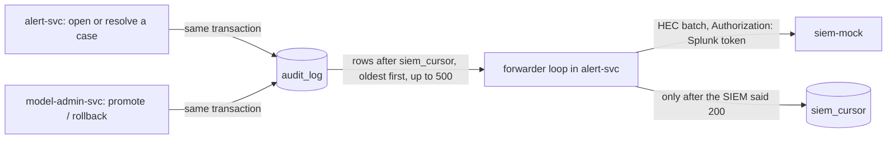

# SIEM hook and the case system's routes (week 4, step 7)

Two links to the bank's other systems:

- **The security team's SIEM** gets every security event as it happens: cases opened and
  resolved, models promoted, rolled back or refused. Here a mock (`siem-mock`) stands in for
  Splunk; it speaks Splunk's HTTP Event Collector (HEC) protocol, so the real one would need only
  a different URL and token.
- **The bank's case-management system** (a machine client, `case-mgmt`, role `case-system`)
  reads a case's status and writes back the decision, by transaction id.

## SIEM: the audit log is the outbox



Every event the SIEM should see is already an audit row, saved in the same transaction as what it
records (`docs/alerts.md`). So nothing new is written on the case path. A loop in alert-svc
(`services/alert-svc/app/siem.py`) sends rows the SIEM hasn't had yet:

| Question | Answer |
|---|---|
| SIEM down? | Nothing is lost. The rows wait in Postgres; the position (`siem_cursor`) moves only after the SIEM answers 200. Cases keep opening: the loop runs apart from the case path |
| Crash after the SIEM accepted, before the position was saved? | That batch goes again. Every event carries its audit row id, and the SIEM drops ids it already has: at least once, shown once |
| Two alert-svc copies? | The position row is locked while a batch is sent (`FOR UPDATE SKIP LOCKED`): one copy sends, the other skips that round |
| Can a row be skipped? | No. Audit rows are written one at a time under the chain's lock (`audit/chain.py`), so their ids become visible in order |
| A batch the SIEM refuses (400)? | It is retried, never skipped: a security event must not quietly disappear. The lag metric shows it |
| Order and timing | Oldest first, at most 500 per request, then once a second when caught up |

Each event carries the row's fields **and its hash and previous hash**, so the SIEM holds a copy
of the chain outside our database: editing an old audit row (ST8) would also disagree with what
the SIEM already has.

**Event format** (one per line, HEC batch mode):

```json
{"time": 1762682400.123, "source": "fraud-platform", "sourcetype": "fraud:audit",
 "event": {"id": 2643, "at": "2026-11-09T10:00:00.123456+00:00", "actor": "case-mgmt",
           "action": "case_resolved", "target": "case:812",
           "details": {"txn_id": "3367131", "outcome": "not_fraud", "external_ref": "TICKET-42"},
           "prev_hash": "8b2b...", "hash": "c41e..."}}
```

**The mock** (`services/siem-mock`): `POST /services/collector/event` checks the token
(`Authorization: Splunk <token>`, constant-time; no token configured means it refuses everything),
checks the whole batch before keeping any of it, and keeps the newest 10,000 events in memory.
`GET /` is the SIEM view (refreshes every 2 s, with each event's delay); `GET /events` is the same
as JSON. Not routed through Kong: `make k8s-siem` (cluster) or http://localhost:8088 (compose).

**Measured by:** `alerts_siem_lag_seconds` (how long the oldest unsent row has waited; 0 when
caught up), `alerts_siem_events_sent_total`, `alerts_siem_send_failures_total` in alert-svc;
`siem_last_event_delay_seconds` and `siem_events_total{outcome}` in the mock.

**Secured like our other services:** its own service account and Linkerd identity, network rules
allowing only alert-svc (and Prometheus for metrics) to reach it, non-root, read-only filesystem.
Its token (`SIEM_TOKEN`) is in the encrypted secrets file (`docs/secrets.md`); compose uses
`siem_dev_only`.

## The case system's routes

The case system knows payments by their transaction id, not by our case numbers.

| Route | Roles | Does |
|---|---|---|
| `GET /v1/cases/txn/{txn_id}` | case-system, analyst | the case's status view: case id, status, decision, score, reasons, model version, degraded, opened and resolved times, who resolved it. **Not** the customer id or the amount, which it doesn't need. 404: no case (approved payments have none) |
| `POST /v1/cases/txn/{txn_id}/decision` | case-system | `{"outcome": "fraud" or "not_fraud", "note": "...", "external_ref": "TICKET-42"}`. Resolves the case exactly as an analyst would: case and audit row in one transaction, `resolved_by` = `case-mgmt`, its ticket number in the audit row. 409 if already resolved (a decision is never overwritten), 404 if no case |

Kong checks the token and the role on each (`deploy/kong/kong.tpl.yml`), 10 requests/s per
client, 4 KB bodies; alert-svc checks the role again. The case system can't use the analyst routes,
and analysts can't write back as the case system (ST2). Each write-back is an audit row, so it
reaches the SIEM like everything else.

## Checks

- `tests/test_siem.py`: event format; the mock's token check, duplicates, whole-batch refusal,
  size cap, escaping in the view; with Postgres, the forwarder sends in order and moves its
  position, keeps rows when the SIEM fails, and never runs in two copies at once; the status view
  hides the customer, the write-back is audited and never overwrites.
- ST2 (`make k8s-st2`): two more routes and the case-system role.
- `make k8s-siem-check`: as `case-mgmt` through Kong, write back a case and time how long until
  the SIEM shows it; then stop the SIEM for `OUTAGE` seconds (default 30), write back another, start
  it again and check the event still arrives.
- ST4 covers the two new network paths.

## Limits

- **The mock keeps events in memory**: a restart empties its view (the rows it had are still in
  the audit log, and new ones keep coming). A real SIEM stores them. Seen on the first deploy:
  the first siem-mock pod received the whole backlog (2,642 rows), then `make k8s-up`'s restart
  replaced it with an empty one.
- **The event view is the newest 10,000**, and the mock has no search; it's for showing the flow.
- **One forwarder sends at a time**, about 500 rows per round trip: thousands per second, far
  above what the platform writes.
- **The case system is one shared client.** A real bank would give it its own certificate or
  key, and per-user identity inside its own tool.
