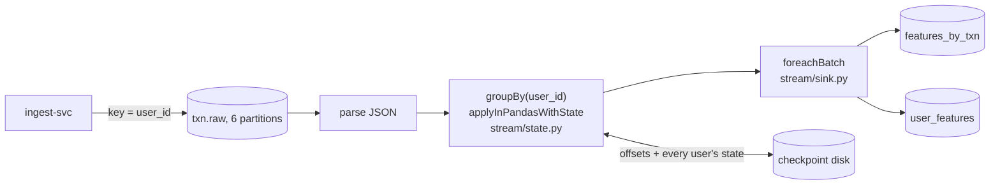

# Streaming feature job (week 4, step 1)

A Spark Structured Streaming job reads every payment from `txn.raw`, keeps state per user, and
writes the **12 history features of each payment, as of that payment**, to Cassandra. The same
features the model uses (`features/history.py`), computed continuously instead of on request.
Course topic: stream processing with keyed state.

## Why scoring doesn't read it

Scoring still reads a user's history rows and computes the features itself, during the request.
Spark works in micro-batches (about one a second), so a feature table it writes can be a second
behind: a payment arriving right after another from the same user could miss it. Reading the
rows never misses one. Switching scoring over is possible later (the per-user state is exactly
what it would need); a week before the feature freeze it isn't worth the risk. The job's output
is for **drift monitoring and retraining** (features of live traffic, as training computed them),
and it shows per-user stream state at work.

## Per-user state

`txn.raw` is keyed by `user_id`, so a user's payments are in one partition, in order: that is why
ingest keys it that way. The job groups by user and keeps, per user (`stream/state.py`):

| State | For |
|---|---|
| payments of the last 30 days: time, amount, txn_id | every windowed feature (1 h, 24 h, 30 d counts, the 24 h sum, the 30 d mean and spread, the zscore) |
| payments in total | `n_prev_txns` |
| the last payment's time | `secs_since_last` |
| every email domain, device and product ever used | `new_P_emaildomain`, `new_DeviceType`, `new_ProductCD` |

With that, `state.features()` gives **exactly** what Manisha's `history_for_one` gives with the
user's whole history; it calls `history_for_one` for the windowed part. Rows older than 30 days
before the user's latest payment are dropped on every update, so state stays small.

| Case | What happens |
|---|---|
| unknown card (`NA` in the id) | features all missing, as training gives them; no state |
| same `txn_id` already in the window | **duplicate**: skipped. Earlier replays re-sent the same payments, and Kafka can redeliver |
| more than 30 days older than the user's latest payment | **late**: dropped (its window is gone) |
| slightly out of order | slotted in by time; it doesn't count later payments as its past |
| unreadable message (no txn_id, user_id or amount, or a time Spark can't read) | grouped under a reserved key (`~unreadable`, which no id can be), counted as `feature_job_payments_total{outcome="unreadable"}`, written nowhere. The time is read with `try_to_timestamp`: a strict cast once failed a whole batch on one fuzzed time, and the job crash-looped retrying it (week 5) |

Inside a micro-batch, a user's payments are sorted by time, then partition and offset.

## Spark settings

| Setting | Value | Why |
|---|---|---|
| Spark | PySpark 4.2.1, local mode `local[2]`, Java 21 | one pod; a real cluster wouldn't fit on this laptop |
| Source | Kafka source, `txn.raw`, up to 20,000 payments per micro-batch, a micro-batch at most every second | the connector jars are pinned to the versions Spark 4.2.1 was built with, baked into the image |
| Shuffle partitions | 6 | one per topic partition |
| State | `applyInPandasWithState`, state is one JSON string per user, no timeout | mature API; the window trimming does the job a timeout would |
| Checkpoint | `/checkpoint/feature-job` on the pod's own disk | offsets and every user's state: a restart resumes exactly where it stopped |
| Output | `foreachBatch`: prepared, idempotent upserts with the Cassandra driver, 32 at a time; writes that fail are tried again (waits of 1, 2, 4, 8, 15 s) | a batch written again after a crash writes the same rows. The first cluster parity run lost a whole batch to one 1 s Cassandra pause, and Spark restarted (about a minute); now only the failed writes are retried, and the batch fails only if Cassandra stays down for about 30 s |
| pandas | 2.3.3 in this image (3.1 elsewhere) | PySpark 4.2 warns it doesn't fully support pandas 3 yet |

**Tables** (`deploy/cassandra/schema.cql`): `features_by_txn`, partitioned by day and sorted by
time, the 12 features plus `written_at`; `user_features`, the latest summary per user. **Login:**
`features` may only write those two tables, not read anything (`make k8s-st4-db` checks it). Its
password is in the encrypted secrets file.

**On Kubernetes** (`deploy/k8s/base/feature-job.yaml`): a **StatefulSet** with one copy and a 1 GiB
disk, because two copies writing one checkpoint would corrupt it; a StatefulSet stops the old pod
before starting the new one and keeps its disk. Non-root, read-only filesystem (`/tmp` and the
checkpoint writable), its own service account and Linkerd identity, network rules allowing only
Redpanda and Cassandra out and Prometheus in. Memory: 1 GiB requested, 2 GiB limit (JVM heap
900 MB). Compose has it too, under a profile so `make up` doesn't start it.

**Metrics** (Grafana "Feature job" panels): `feature_job_payments_total{outcome}`,
`feature_job_rows_written_total{table}`, `feature_job_batch_seconds`, and
`feature_job_delay_seconds`, from the payment entering `txn.raw` to its features being written.

## The Python writer (the fallback)

`stream/python_writer.py` does the same with a plain Kafka consumer: the same state code, rows,
writes and metrics. It keeps state in memory and rebuilds it from the start of the topic when it
starts. It was built first, as the fallback if Spark didn't work by Sat 14, and as the baseline for
Spark's throughput. The pod runs either: `JOB=spark` (default) or `JOB=python`.

## Checks

| Check | How | Result |
|---|---|---|
| state = reference | `tests/test_stream_state.py`: random histories vs `history_for_one` (full past), and a table vs `add_history` (training's code) | all equal |
| job logic | `tests/test_spark_job.py`: Spark's per-user function across micro-batches, duplicates, unknown users; the Python writer gives the same rows | pass |
| Spark in its image, no cluster | `make spark-smoke`: 10,000 stream payments from files through the real query (5 micro-batches), read-only and non-root, vs training's code | **10,000 of 10,000 equal** |
| parity on the cluster | `make k8s-spark-parity` (or `JOB=python`): the first 10,000 stream payments into a fresh topic `txn.parity`, the job with empty state, then `stream/parity.py` compares `features_by_txn` with `add_history`. Target 99.9% | `docs/results/spark.md` |
| throughput | `make k8s-spark-throughput` (and `JOB=python`): 100,000 payments loaded into `txn.bench` first, then the job started; payments per second after its first batch | `docs/results/spark.md` |

The two cluster runs use their own topics and a new checkpoint folder, then put the job back on
`txn.raw` and its normal checkpoint, even if the run fails.

## Limits

- **Writes go through the Spark driver** (`foreachBatch` collects each batch). Fine at our volume;
  a large deployment would use the Spark Cassandra connector, writing from the executors.
- **One copy in local mode.** Spark scales by topic partitions and executors; this laptop can't
  hold a Spark cluster.
- **Features are about a second behind** (micro-batches), which is why scoring doesn't read them.
- **Unreadable messages are dropped**, and counted (`outcome="unreadable"`), in both engines; `make spark-smoke` sends four through the real query.
- **The image is about 1.8 GB** (Java and Spark). Spark's bundled Java libraries carried known
  vulnerabilities: see "Supply chain" below.

## Supply chain

The first Trivy scan of this image found **62 HIGH/CRITICAL findings, all in Java libraries
PySpark 4.2.1 ships** (our code and the OS packages were clean). PySpark 4.3.0 ships the same
versions, so upgrading doesn't help. `services/feature-job/patch_jars.sh` runs at build time:

| What | Change |
|---|---|
| netty 4.2.13 (Spark's networking): 1 CRITICAL, 12 HIGH | every netty module to 4.2.17, so they stay matched |
| jackson 2.21.2, guava 33.6.0, lz4-java 1.11.0, snappy-java 1.1.10.8 | 2.21.7, 33.7.2, 1.11.4, 1.1.10.9: patch releases of the same lines |
| Derby and Thrift (Hive's metastore), JLine (the shell), the Spark Connect REPL | removed: this job never loads them |

Every download is checked against Maven Central's SHA-1 before use. The swapped jars pass
`make spark-smoke` (10,000 of 10,000 equal) and the cluster runs.

**Left: 23 findings, in 4 jars that bundle their own copies** and can't be patched without
rebuilding Spark. Each is waived for that one jar, with its reason, in `.trivyignore.yaml`:

| Jar | Copies inside | Why it's acceptable here |
|---|---|---|
| `hadoop-client-runtime-3.5.0` (13) | jackson 2.18, guava, jetty, jline | Hadoop is used only to write the checkpoint to local disk; no Hadoop server or shell runs; JSON comes only from our topic and checkpoint |
| `parquet-jackson-1.17.0` (8) | jackson 2.19 | the job reads and writes no Parquet |
| `spark-core_2.13-4.2.1` (1) | jetty | the Spark web UI is switched off |
| `spark-network-common_2.13-4.2.1` (1) | guava | local mode: one process; no other pod may connect (NetworkPolicy, Linkerd) |

These go away with a Spark release that updates Hadoop and Parquet; the scan shows them again
the day a waiver no longer matches.
